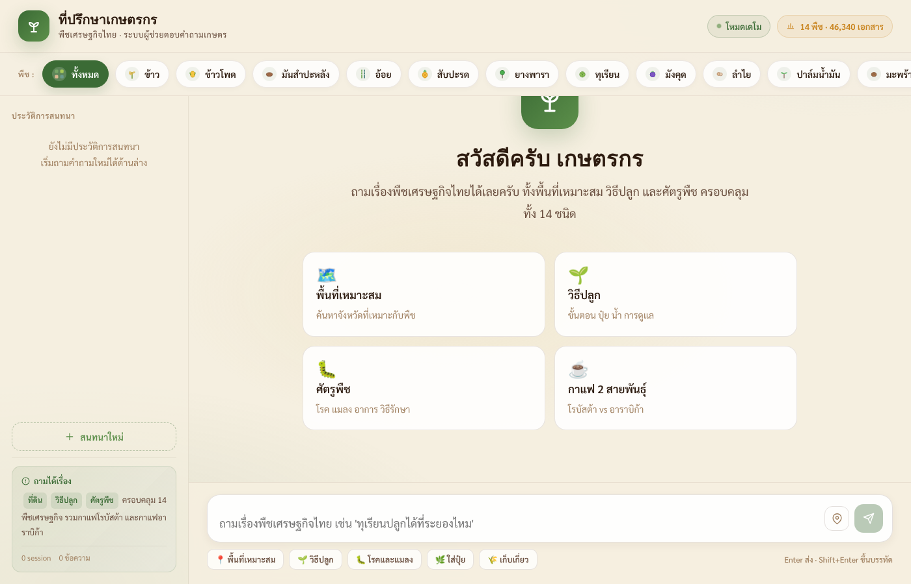
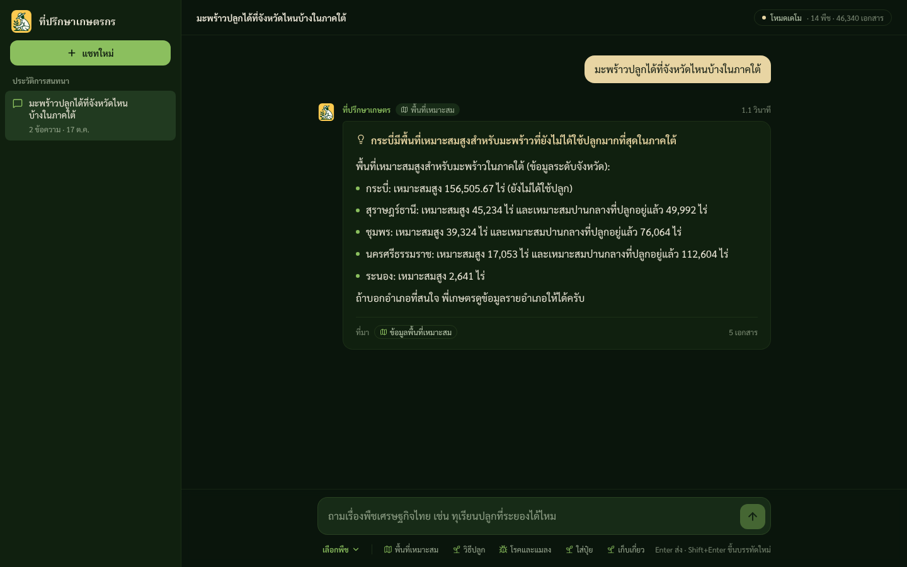

# Economic Crops Chat — พี่เกษตร 

แชทบอทภาษาไทยที่ตอบคำถามเรื่องการปลูกพืชเศรษฐกิจไทย 14 ชนิด โดยค้นจากข้อมูลจริงของหน่วยงานรัฐก่อนแล้วจึงให้ AI เรียบเรียงคำตอบ (RAG — Retrieval-Augmented Generation)

**🔗 Live demo:** _chatbot-project-phi-nine.vercel.app_




## โปรเจกต์นี้ทำอะไร

เกษตรกรหรือคนที่สนใจปลูกพืช พิมพ์คำถามเป็นภาษาไทยธรรมดา แล้วระบบตอบได้ 3 เรื่อง:

| ประเภทคำถาม | ตัวอย่าง | ข้อมูลที่ใช้ตอบ |
|---|---|---|
|  **พื้นที่เหมาะสม** | "มะพร้าวปลูกได้ที่จังหวัดไหนบ้างในภาคใต้" | ชั้นความเหมาะสมของที่ดิน รายจังหวัด/อำเภอ (ไร่) จากข้อมูล Agri-Map — 45,746 รายการ ครอบคลุม 77 จังหวัด |
|  **วิธีปลูกและดูแล** | "วิธีปลูกทุเรียนและการดูแลที่ถูกต้อง" | คู่มือการปลูกพืชแต่ละชนิด (การเตรียมดิน ระยะปลูก ปุ๋ย น้ำ การเก็บเกี่ยว) |
|  **โรคและศัตรูพืช** | "ข้าวเป็นโรคอะไรได้บ้าง มีอาการอย่างไร" | ฐานข้อมูลโรคและแมลง 97 รายการ (ระยะที่พบ ส่วนที่ถูกทำลาย อาการ) |

พืชที่รองรับ: ข้าว ข้าวโพด มันสำปะหลัง อ้อย สับปะรด ยางพารา ทุเรียน มังคุด ลำไย ปาล์มน้ำมัน มะพร้าว เงาะ กาแฟโรบัสต้า กาแฟอาราบิก้า

### ระบบทำงานอย่างไร

```
คำถาม ─▶ แยกเจตนา ─▶ ค้นเอกสารที่เกี่ยวข้อง ─▶ ให้ LLM เรียบเรียงคำตอบจากเอกสาร ─▶ คำตอบ + แหล่งข้อมูล
```

1. **กรองหัวข้อ** — คำถามที่ไม่เกี่ยวกับเกษตรจะได้คำตอบปฏิเสธอย่างสุภาพ ไม่ต้องค้นข้อมูล
2. **แยกเจตนา (intent)** — ดูจากคำสำคัญว่าถามเรื่องที่ดิน วิธีปลูก หรือศัตรูพืช และดึงชื่อพืช จังหวัด และอำเภอออกมาจากคำถาม
3. **ค้นข้อมูล** — แปลงคำถามเป็นเวกเตอร์ด้วยโมเดล `BAAI/bge-m3` (รองรับภาษาไทย) แล้วค้นใน ChromaDB โดยกรองตามชนิดพืช จังหวัด และประเภทข้อมูล เพื่อไม่ให้ได้ข้อมูลของพืชอื่นมาปน
4. **สร้างคำตอบ** — ส่งเอกสาร 5 อันดับแรกให้ LLM ([Typhoon](https://opentyphoon.ai) โมเดลภาษาไทย) ตอบตามกฎใน system prompt ให้ใช้เฉพาะข้อมูลที่ให้ไปเท่านั้น และบอกตรงๆ เมื่อไม่มีข้อมูล
5. **เก็บประวัติ** — บันทึกบทสนทนาและสถิติคำถามรายวันใน MongoDB

### งานด้านข้อมูล

- `RAG/dataset_local.py` แปลงไฟล์ CSV กว่า 4,000 ไฟล์ (จัดเก็บแยกตามพืช/ภาค/จังหวัด) ให้เป็นเอกสารสำหรับ RAG
- แก้ปัญหาข้อมูลดิบ เช่น ชื่อไฟล์ที่ไม่มีชื่อจังหวัด ไฟล์ที่วางผิดโฟลเดอร์ การสะกดไม่ตรงกัน ("อราบิก้า", "สับประรด") และการพิมพ์ภาษาไทยที่หน้าตาเหมือนกันแต่เป็นคนละตัวอักษร (`เเ` กับ `แ`, `ํา` กับ `ำ`)
- ระวังกรณีพิเศษของภาษาไทย เช่น "ข้าวโพด" มีคำว่า "ข้าว" อยู่ข้างใน หรือ "เลย" "ตาก" "แพร่" ที่เป็นทั้งชื่อจังหวัดและคำทั่วไป

### Tech stack

| ส่วน | เทคโนโลยี |
|---|---|
| Frontend | React 18, Vite, react-markdown |
| Backend | Node.js, Express, MongoDB (Mongoose) |
| RAG API | Python, FastAPI, ChromaDB, sentence-transformers (bge-m3) |
| LLM | Typhoon API (หรือ LLM อื่นที่ใช้ API แบบเดียวกับ OpenAI เช่น Ollama) |
| Deploy | Vercel, Render, Hugging Face Spaces, MongoDB Atlas, GitHub Actions |

### โครงสร้างโปรเจกต์

| ไฟล์ | หน้าที่ |
|---|---|
| `RAG/dataset_local.py` | แปลง CSV ใน `data/RawData` → เอกสาร RAG ใน `data/cleaned` |
| `RAG/vector_db.py`, `RAG/build_db.py` | โมเดล embedding + ChromaDB และสคริปต์สร้าง Vector DB |
| `RAG/rag_prototype.py` | API `/ask`: กรองหัวข้อ → แยกเจตนา → ค้นข้อมูล → ให้ LLM ตอบ |
| `RAG/constants.py` | รายชื่อพืช/จังหวัด และตัวช่วย normalize ภาษาไทย |
| `backend/` | API เก็บประวัติแชทและสถิติ และส่งคำถามต่อให้ RAG |
| `frontend/` | หน้าเว็บแชท (มีโหมดเดโมในตัว ดู `src/utils/demoApi.js`) |

---

## Deploy หน้าเว็บอย่างเดียว (โหมดเดโม)

เปิดดูหน้าเว็บและลองถามคำถามตัวอย่างได้ **ไม่ต้องมี backend, AI หรือฐานข้อมูล** และไม่มีค่าใช้จ่าย
คำตอบในโหมดนี้เป็นคำตอบตัวอย่างที่เรียบเรียงไว้จากข้อมูลจริงในโปรเจกต์ (ไม่ใช่ AI ตอบสด)

1. สมัคร [vercel.com](https://vercel.com) ด้วยบัญชี GitHub
2. **Add New → Project** → เลือก repo นี้
3. ตั้ง **Root Directory** เป็น `frontend` (Vercel จะรู้เองว่าเป็น Vite) → **Deploy**

เสร็จแล้ว ได้ลิงก์แบบ `https://<ชื่อโปรเจกต์>.vercel.app` และทุกครั้งที่ push เข้า `main` เว็บจะอัปเดตเอง
(โหมดเดโมเปิดอยู่แล้วจากไฟล์ `frontend/.env.production`)

---

## Deploy ระบบเต็ม (AI ตอบได้ทุกคำถาม)

ทำครั้งเดียวตามลำดับนี้ หลังจากนั้นทุกครั้งที่ merge เข้า `main` ระบบจะ deploy เอง ใช้แผนฟรีทั้งหมด

```
Vercel (frontend) → Render (backend) + MongoDB Atlas → Hugging Face Spaces (RAG) → Typhoon API
```

### 1. Typhoon API key
สมัครที่ [playground.opentyphoon.ai](https://playground.opentyphoon.ai) → สร้าง API key

### 2. RAG → Hugging Face Spaces
1. สมัคร [huggingface.co](https://huggingface.co) → Settings → Access Tokens → สร้าง token แบบ **Write**
2. ใน GitHub repo นี้ → Settings → Secrets and variables → Actions
   - แท็บ **Secrets**: เพิ่ม `HF_TOKEN` = token จากข้อ 1
   - แท็บ **Variables**: เพิ่ม `HF_SPACE_ID` = `<ชื่อผู้ใช้ HF>/agri-rag`
3. GitHub → Actions → **Deploy RAG to Hugging Face Spaces** → Run workflow
   ครั้งแรกใช้เวลานาน (ต้อง embed ~46,000 เอกสาร) ครั้งต่อไปถ้าข้อมูลไม่เปลี่ยนจะเร็ว
4. เปิด Space ที่ได้ → Settings → **Variables and secrets** → เพิ่ม secret
   - `LLM_API_KEY` = Typhoon key
   - `RAG_API_KEY` = ตั้งรหัสอะไรก็ได้ที่เดายาก (ใช้อีกทีในข้อ 4)
5. รอ Space build เสร็จ แล้วเปิด `https://<ชื่อผู้ใช้>-agri-rag.hf.space/` ต้องเห็น `RAG API is Online`

### 3. MongoDB Atlas
สร้าง cluster ฟรี (M0) ที่ [mongodb.com/atlas](https://www.mongodb.com/atlas) → สร้าง database user →
Network Access เพิ่ม `0.0.0.0/0` (Render ไม่มี IP คงที่) → คัดลอก connection string

### 4. Backend → Render
[render.com](https://render.com) → New → **Blueprint** → เลือก repo นี้ (ใช้ `render.yaml`) แล้วกรอก
- `MONGODB_URI` = connection string จาก Atlas
- `RAG_API_URL` = `https://<ชื่อผู้ใช้>-agri-rag.hf.space/ask`
- `RAG_API_KEY` = ค่าเดียวกับที่ตั้งใน Space
- `CORS_ORIGINS` = URL ของ frontend บน Vercel

### 5. Frontend → Vercel
ทำตามหัวข้อ "Deploy หน้าเว็บอย่างเดียว" ด้านบน แล้วเพิ่ม Environment Variables ใน Vercel → Settings:
- `VITE_DEMO_MODE` = `false`
- `VITE_API_URL` = URL ของ backend บน Render เช่น `https://agri-chatbot-backend.onrender.com`

แล้วกด Redeploy

> ⏰ แผนฟรีของ Render และ Hugging Face จะหลับเมื่อไม่มีคนใช้สักพัก คนแรกที่เข้าหลังจากนั้นต้องรอ 1–2 นาที

---

## รันในเครื่อง

สิ่งที่ต้องมี: Node.js 18+, Python 3.10+, MongoDB และ API key ของ Typhoon

### 1. RAG API

```bash
cd RAG
pip install -r requirements.txt

python build_db.py                                   # สร้าง Vector DB (ครั้งแรก หรือหลังข้อมูลเปลี่ยน) — ใช้เวลานาน
LLM_API_KEY=<typhoon key> python rag_prototype.py    # เปิดที่ http://localhost:8000
```

| env | ค่าเริ่มต้น | ใช้ทำอะไร |
|---|---|---|
| `LLM_API_KEY` | – | API key ของ Typhoon |
| `LLM_MODEL` | `typhoon-v2.5-30b-a3b-instruct` | ชื่อโมเดล |
| `LLM_BASE_URL` | `https://api.opentyphoon.ai/v1` | API ที่ใช้รูปแบบเดียวกับ OpenAI |
| `RAG_API_KEY` | – | ถ้าตั้งไว้ `/ask` ต้องส่ง header `X-API-Key` ตรงกัน |

อยากใช้ Ollama ในเครื่องแทน: `LLM_BASE_URL=http://localhost:11434/v1 LLM_MODEL=qwen2.5:7b python rag_prototype.py`

ถ้าแก้ไฟล์ CSV ใน `data/RawData` ให้รัน `python dataset_local.py` ก่อน แล้วค่อย `python build_db.py`

### 2. Backend

```bash
cd backend
cp .env.example .env   # แก้ MONGODB_URI / RAG_API_URL ตามเครื่อง
npm install
npm run dev
```

### 3. Frontend

```bash
cd frontend
npm install
npm run dev            # เปิด http://localhost:5173 (ต่อ backend ในเครื่อง)
```

อยากดูโหมดเดโมในเครื่อง: `VITE_DEMO_MODE=true npm run dev`

---

## ข้อจำกัดที่รู้อยู่

- ยังไม่มีระบบผู้ใช้ — ทุกคนที่เข้าเว็บ (ระบบเต็ม) จะเห็นและลบประวัติแชทของทุกคนได้
- ข้อความบางส่วนในคู่มือการปลูก (`plant_growing_rag_ready.jsonl`) สระเพี้ยนจากการดึงข้อความออกจาก PDF ทำให้ค้นเจอยากขึ้น
- การแยกเจตนาใช้คำสำคัญ คำถามที่ใช้คำแปลกไปจากที่กำหนดอาจถูกจัดประเภทผิด

---

โปรเจกต์กลุ่ม 13 — Economic Crops Chat: ระบบแนะนำการปลูกพืชเศรษฐกิจในไทย
